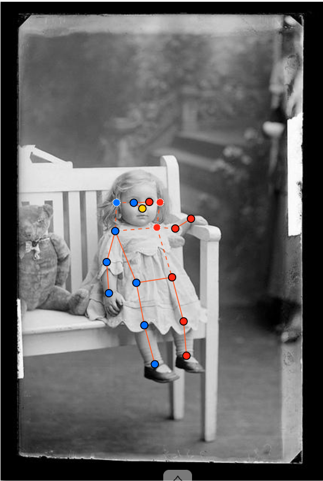
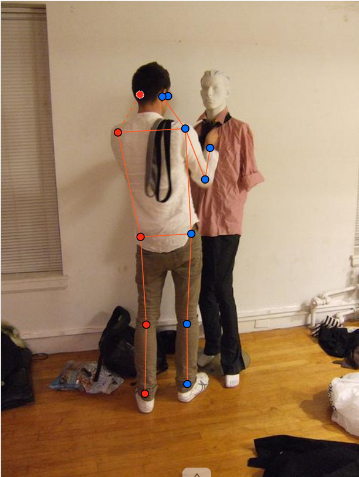
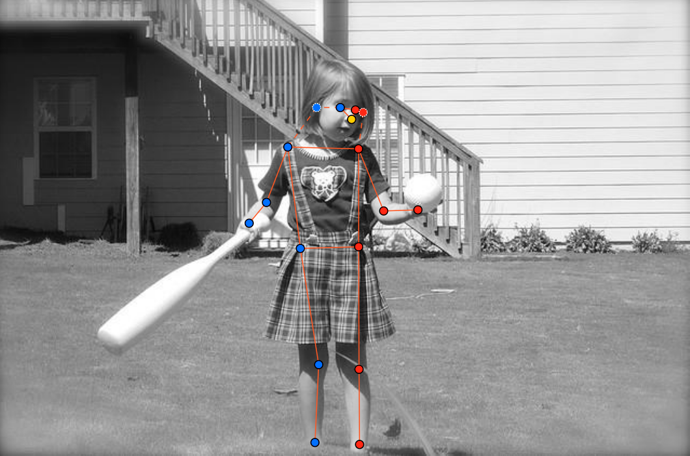
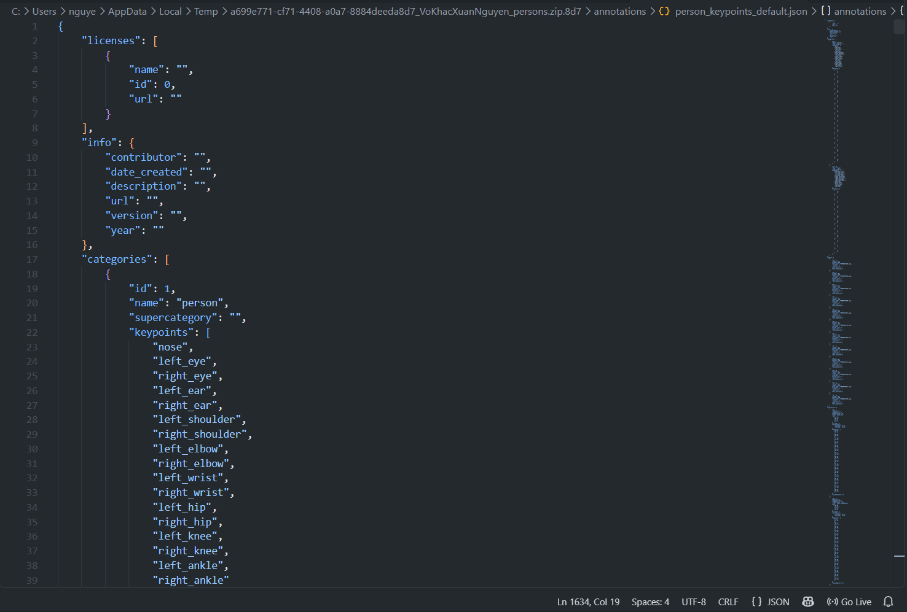

# Báo cáo cá nhân — HoVaTen-MSSV

Đổi tên file theo quy tắc `MSSV_HoTen.md`. Ví dụ: `20241234_NguyenVanAn.md`.

Dữ liệu: 12 ảnh người COCO val2017 (Lin et al., 2014) và 8 ảnh chân dung Wikimedia Commons, chỉ dùng trong lớp.

## 0. Thông tin học viên

- Họ tên: Võ Khắc Xuân Nguyên
- MSSV: 2A202603122
- Email:26ai.nguyenvkx@vinuni.edu.vn
- Link repository:https://github.com/Nguyenvkx/K5-L2-VoKhacXuanNguyen-2A202603122-KeypointPose
- Phiên bản CVAT (Help → About): 2.82.1
- Máy: hệ điều hành win11 · RAM 16 GB · chạy CVAT chế độ đầy đủ
- Bộ ảnh (`src/exports/assignment.json` do `lab.py setup` tạo): có / không
- Giờ bắt đầu: 16h30
- Giờ kết thúc: 18h50

## 1. Kiểm tra label (CP0)

| Label | Kiểu | Số điểm | Tên điểm đúng bảng của lab? | Đúng thứ tự? | Số cạnh |
|---|---|---:|---|---|---:|
| `person` |Skeleton |17 | Có | Có | 19 |
| `face` |Skeleton |13 | Có | Có | 13 |

Mẫu `person` dựng theo người quay mặt về camera (các điểm `left_*` nằm bên phải khung mẫu)? Có

Cách đổi cờ `occluded` / `outside` cho **một điểm** trên phiên bản CVAT này (một câu):

Chọn điểm keypoint trong skeleton, sau đó sử dụng tùy chọn Occluded khi điểm bị che khuất hoặc Outside khi điểm nằm ngoài khung hình, nếu phiên bản CVAT hỗ trợ các thuộc tính này cho từng điểm.

## 2. Số lượng đã gán và thời gian (CP1, CP2)

| Nhóm ảnh | Số ảnh | Số skeleton đã gán | Số người dưới 60 px (không gán) | Số poster / gương / màn hình bỏ qua | Thời gian (phút) |
|---|---:|---:|---:|---:|---:|
| `easy` | 5 |5 |0 |0 | |
| `occluded` | 3 |5|0 |0 | |
| `back` | 2 |4 |0 |0 | |
| `small` | 1 |2 |2 |0 | |
| `crowd` | 1 |3 |0 |0 | |
| `faces` | 8 |8 |2 |0 | |

- Số ảnh người đã xong ở mốc phút 105: 10 / 10
- Thời gian thực tế (phút): CP1 20p · CP2 30p · CP3 20p
- Ảnh tốn thời gian nhất là ảnh nào, vì sao?
   Ảnh tốn thời gian nhất là 000000272026.jpg vì các vị trí bị che khuất khá nhiều và tư thế khó.

## 3. Bảng ca khó (CP1, CP2)

Mỗi điểm bạn phân vân một dòng, nhất là phân vân giữa `v = 1` và `v = 0`, hoặc không chắc hướng người.

| Ảnh | Người / mặt | Điểm | Cờ đã chọn | Phân vân giữa | Lý do chọn |
|---|---|---|---:|---|---|
|000000090646.jpg |Người đứng quay lưng |left_ear |v = 1 |Tai trái bị khuất. Đường viền đầu và hướng quay có đủ để bạn ước lượng vị trí tai, hay nên dùng v = 0? | |
| | | | | | |
| | | | | | |

## 4. Bảng tự review (CP3)

Đi từ ảnh cuối về ảnh đầu. 5 ảnh người (ít nhất 2 ảnh `back` hoặc `crowd`) và 3 ảnh mặt. Ít nhất 8 dòng, kể cả dòng `ok`. Ghi lỗi trước, sửa sau.

Mã lỗi dùng đúng một trong: `lr_swap`, `vis_flag`, `position`, `missing`, `extra`, `ok`.

| Ảnh | Người / mặt | Điểm | Mã lỗi | Ghi chú | Đã sửa? |
|---|---|---|---|---|---|
|000000461389.jpg |Người | | |ok | |
| 000000359340.jpg|Người | | |ok| |
|000000297227.jpg |Người | | |ok | |
|000000272026.jpg |Người | | |ok | |
|000000090646.jpg |Người | | |ok | |
|face_41666.jpg |mặt | | | ok| |
|face_415073.jpg |mặt | | |ok| |
|face_255797.jpg |mặt | | |ok | |

Tổng hợp số lỗi theo mã:

| `lr_swap` | `vis_flag` | `position` | `missing` | `extra` | `ok` |
|---:|---:|---:|---:|---:|---:|
| | | | | | |

Điểm còn phân vân giữa `v = 1` và `v = 0` (ghi cả hai lựa chọn và lý do chọn):

...

## 5. Kiểm file xuất và kết quả tự kiểm (CP4)

Tự kiểm tay trong file JSON:

| File | Người / mặt kiểm (ảnh, thứ tự) | Số phần tử `keypoints` | Điểm `outside` ra `v = 0`, `occluded` ra `v = 1`? | `num_keypoints` khớp? |
|---|---|---:|---|---|
| `VoKhacXuanNguyen_persons.zip` |000000090646.jpg |51 |Có 4 điểm `v = 0`, 1 điểm `v = 1` |Khớp (13) |
| `HoVaTen_persons.zip` |000000272026.jpg |51 |Có 3 điểm `v = 0`, 3 điểm `v = 1` |Khớp (14) |
| `HoVaTen_faces.zip` |face_255797.jpg |39 |Có 8 điểm `v = 1` | |

Sau khi xuất, CVAT ghi `occluded` thành `v = ___` và `outside` thành `v = ___`. Tọa độ của điểm `outside` trong file là `0, 0` hay tọa độ cũ?
   Là Tọa độ cũ. Ví dụ, một điểm trong `000000090646.jpg` có bộ ba `(210.0, 132.51, 0)
Hai job đã chuyển sang completed trên CVAT? Có

Dán phần **TÓM TẮT** in ra từ `src/check_submission.py`:

```text
- File person: VoKhacXuanNguyen_bonus_persons.zip
  Số ảnh: 3 · số skeleton `person`: 10 · mỗi annotation 51 số
  Skeleton theo ảnh: 000000161603=4, 000000196853=3, 000000373426=3
  Cờ v: v=2 99 (58%) · v=1 23 (14%) · v=0 48 (28%)
  num_keypoints trung bình: 12.2
- File face: VoKhacXuanNguyen_bonus_faces.zip
  Số ảnh: 5 · số skeleton `face`: 5 · mỗi annotation 39 số
  Skeleton theo ảnh: face_102517=1, face_280788=1, face_296417=1, face_317330=1, face_45276=1
  Cờ v: v=2 64 (98%) · v=1 1 (2%) · v=0 0 (0%)
  num_keypoints trung bình: 13.0
- Ghi chú: 48 điểm v = 0 vẫn mang tọa độ cũ (CVAT 2.x xuất như vậy; chuẩn COCO ghi 0, 0). Không phải lỗi: điểm v = 0 bị bỏ qua khi huấn luyện và khi chấm.
- Số [LỖI]: 0 · số [CẢNH BÁO]: 1
Kết quả: ĐẠT (đọc lại từng cảnh báo ở trên)
```

Các `[CẢNH BÁO]` còn giữ nguyên và lý do:

000000272026.jpg #2: cặp wrist nằm ngược phía so với các cặp còn lại. Có thể đổi trái/phải một cặp (`lr_swap`), hoặc tay / chân bắt chéo thật: kiểm lại.

## 6. Ảnh chụp màn hình

1. Label `person` trong label constructor (đủ 17 điểm có tên):

   

2. Một người quay lưng đã gán, cờ đã đặt:

   

3. Một khuôn mặt đã gán 13 điểm, phóng to vùng mắt:

   

4. Một đoạn JSON xuất của một người:

   

Nguồn ảnh: COCO val2017 / Wikimedia Commons.

## 7. Tự đánh giá

1. Lỗi bạn mắc nhiều nhất hôm nay, và cách bạn sẽ tránh ở dự án thật:

   Không

2. Một quy tắc bạn đề xuất thêm vào guideline (kèm ảnh ví dụ nếu có):

   Không

3. Nhãn của bạn đi vào model ở đâu? Chọn một lỗi bạn đã sửa và nói nó sẽ làm model học sai thế nào (heatmap, trọng số trong loss, hay bước lật ảnh):

   ...

## 8. Khó khăn và lỗi kỹ thuật

...

## Bonus (nếu làm)

### B1 — 3 ảnh người khó thêm

| Ảnh | Số skeleton | Số người dưới 60 px | Ca khó nhất |
|---|---:|---:|---|
|000000161603.jpg |4 |1 | |
|000000196853.jpg |3 |0 | |
|000000373426.jpg |3 |0 | |

Kết quả `src/check_submission.py` cho `HoVaTen_bonus_persons.zip`:

```text
- File person: VoKhacXuanNguyen_bonus_persons.zip
  Số ảnh: 3 · số skeleton `person`: 10 · mỗi annotation 51 số
  Skeleton theo ảnh: 000000161603=4, 000000196853=3, 000000373426=3
  Cờ v: v=2 99 (58%) · v=1 23 (14%) · v=0 48 (28%)
  num_keypoints trung bình: 12.2
- File face: VoKhacXuanNguyen_bonus_faces.zip
  Số ảnh: 5 · số skeleton `face`: 5 · mỗi annotation 39 số
  Skeleton theo ảnh: face_102517=1, face_280788=1, face_296417=1, face_317330=1, face_45276=1
  Cờ v: v=2 64 (98%) · v=1 1 (2%) · v=0 0 (0%)
  num_keypoints trung bình: 13.0
- Ghi chú: 48 điểm v = 0 vẫn mang tọa độ cũ (CVAT 2.x xuất như vậy; chuẩn COCO ghi 0, 0). Không phải lỗi: điểm v = 0 bị bỏ qua khi huấn luyện và khi chấm.
- Số [LỖI]: 0 · số [CẢNH BÁO]: 1
Kết quả: ĐẠT (đọc lại từng cảnh báo ở trên)
```
```

### B2 — 5 ảnh khuôn mặt đen trắng / hồng ngoại

Ảnh không màu khó hơn ở điểm nào? Kính râm trên ảnh hồng ngoại có còn là `v = 1` không?

- Ảnh đen trắng khó gán nhãn hơn ở viền mí mắt và khóe miệng vì thiếu thông tin màu.
- Với kính râm trong ảnh hồng ngoại, em xét từng điểm mắt. Nếu ảnh vẫn cho thấy rõ điểm đó thì gán v = 2. Nếu kính che điểm nhưng vẫn có thể ước lượng vị trí đủ chắc thì gán v = 1. Nếu không đủ căn cứ để xác định vị trí thì gán v = 0

### B3 — Model so với nhãn của tôi (không tính điểm)

- Demo đã dùng:
- Ảnh đã thử:

1. Model có trả điểm cho khớp bị che, hay khớp ngoài ảnh không? Confidence ở các điểm đó thế nào?

   ...

2. Với người quay lưng, model có đổi trái/phải không?

   ...

3. Bộ điểm của model có giống 17 điểm COCO không?

   ...

## 9. Tài liệu tham khảo và công cụ AI đã dùng

...
